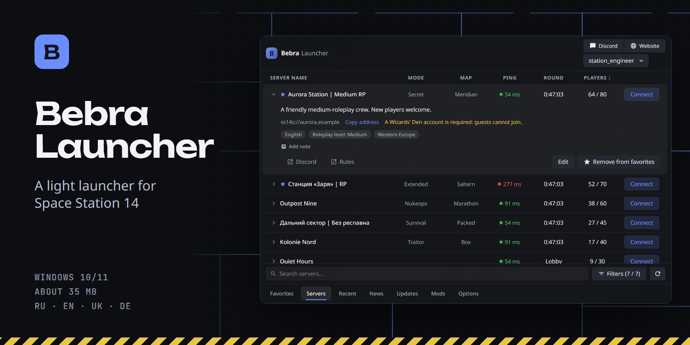
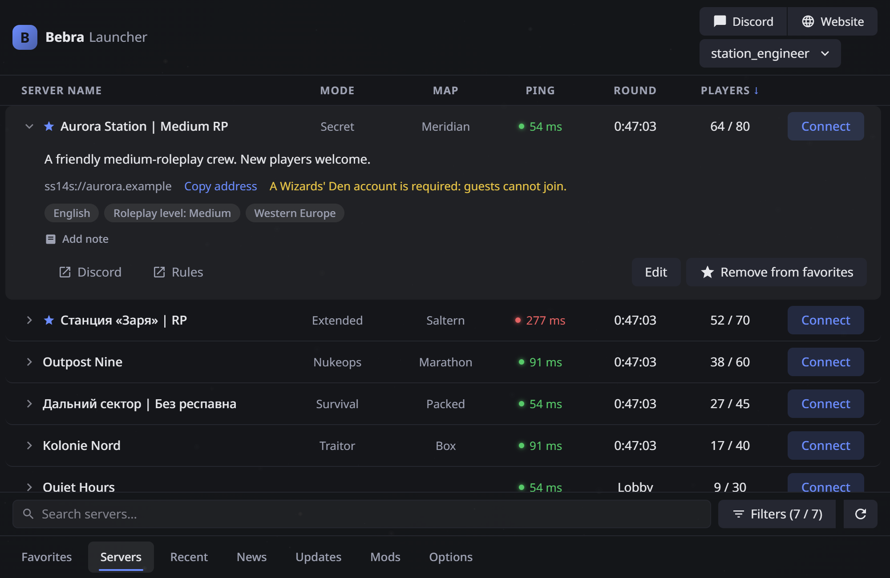
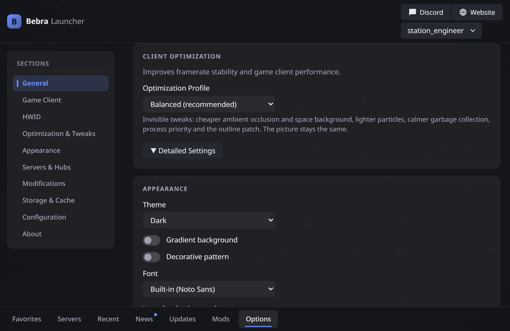
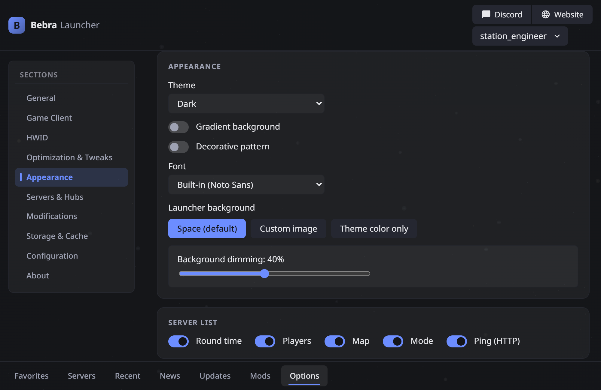
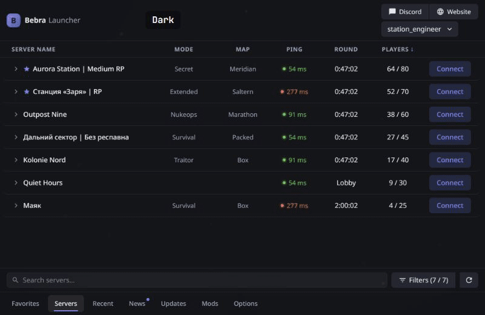

<p align="center">
  
</p>

<p align="center">
  <a href="README.md">Русский</a> · <b>English</b>
</p>

<p align="center">
  <a href="../../releases/latest"></a>
</p>

<p align="center">
  
  
  
</p>

BebraLauncher lists Space Station 14 servers, remembers your accounts and starts the game. The layout will feel familiar from the official launcher, and the installer is about 35 MB with the game loader and .NET included.

<p align="center">
  
</p>

<sub>Servers and accounts in the screenshots are fictional.</sub>

## Features

**Servers.** A list from the Wizards' Den hub (hubs are configurable), with sorting, search and filters for language, region, roleplay level and player count. The saved list opens when you are offline.

**Favorites and history.** Favorite servers, including ones outside the hub, recent servers, play time per server, notes, direct connect and `ss14://` links.

**Accounts.** Sign-in through the official Wizards' Den service with two-factor codes, and guest play where a server allows it. Each server remembers its account.

**Launching.** Downloads and verifies the build, engine and modules, with progress and cancel. The game can reconnect when a server asks it to (redial), and the launcher window minimizes while you play.

**Client optimization.** The `standard`, `balanced` and `optimized` profiles, or individual switches.

**Appearance.** 17 ready-made themes plus your own, shareable as JSON. You can set your own picture as the background and adjust its dimming and blur. Font and interface scale are configurable too.

**Localization and mods.** Text packs with translations (`.zip`) and client patches (`.dll`) on a separate tab.

**Updates.** New versions come from GitHub releases, are checked against an Ed25519 signature, and install on exit or at the press of a button.

<table>
  <tr>
    <td width="50%"></td>
    <td width="50%"></td>
  </tr>
</table>

<p align="center">
  
</p>

## Installation

1. Download `*-setup.exe` from the [releases page](../../releases/latest).
2. Run the installer. It does not have a Windows code-signing certificate yet, so SmartScreen may warn you: click "More info", then "Run anyway".
3. Sign in, or play as a guest.

Requires Windows 10 or 11 (x64) and WebView2, which these systems usually already have.

## Before you install

> [!IMPORTANT]
> **This is an unofficial project.** It is not affiliated with Space Wizards or the authors of Space Station 14.

> [!WARNING]
> **HWID.** The launcher gives the game its own hardware ID instead of the real one and, by default, generates a new one before every launch. You can change this in the "HWID" section. Servers may forbid this: do not use it to get around bans.

> [!WARNING]
> **Mods.** `.dll` patches run inside the game with your permissions, and neither their author nor a signature is checked. Install only builds you trust. A server may treat patches as cheating. All patches can be turned off in one action, and a file changed after installation is not loaded.

**Your data.** Your password is not stored or logged. The token lives in Windows Credential Manager and renews itself. Game files are verified with SHA-256 and Ed25519. Text packs may contain translation files only, and no code from them runs.

## Building from source

You need Rust (stable), Node.js 22, pnpm 10 and the .NET 10 SDK. The installer also needs the VC++ CRT and internet access.

```powershell
# development mode (build the Loader first, see loader/README.md)
cd app; pnpm install; pnpm tauri dev

# the interface alone, on sample data, with no backend
cd app; pnpm dev

# the installer
pwsh scripts/build-release.ps1
```

<details>
<summary>Checks before a commit</summary>

```powershell
cargo fmt --all --check
cargo clippy --workspace --all-targets -- -D warnings
cargo test --workspace
cd app; pnpm install; pnpm check; pnpm test
dotnet restore loader/SS14.Loader/SS14.Loader.csproj --locked-mode
dotnet build loader/SS14.Loader/SS14.Loader.csproj -c Release -warnaserror --no-restore
```
</details>

<details>
<summary>Repository layout</summary>

| Path | What it is |
| --- | --- |
| `crates/core` | The core, no UI: hub, server, auth, content, engine, launch, storage |
| `crates/cli` | The `bebra` debug CLI |
| `app/` | The Svelte interface and the Tauri shell (`app/src-tauri`) |
| `loader/` | `SS14.Loader` from the official launcher, and client patches |
| `mods/` | Sample Harmony client patches |
| `scripts/` | Build, release, and the README images (`readme-media`) |

More, in Russian: [internals notes](NOTES.md), [hub and server protocol](docs/protocol.md), [changelog](CHANGELOG.md), [versioning rules](docs/CHANGELOG_RULES.md).
</details>

## Contributing

Report bugs and ideas in [Issues](../../issues), and read [CONTRIBUTING](.github/CONTRIBUTING.md) before a pull request. Report vulnerabilities as described in [SECURITY](.github/SECURITY.md), not in public issues.

## License

The project's code is under the [MIT](LICENSE) license. `loader/` contains SS14.Launcher code ([MIT](loader/LICENSE-SS14.Launcher.txt)), and the licenses of the other installer components are listed in [THIRD-PARTY-NOTICES](loader/THIRD-PARTY-NOTICES.txt).

Some theme palettes and settings come from MusyaLoader (AGPL). Their license status is being reviewed.

Space Station 14 belongs to its authors. The name is used only to say which game the launcher works with.

## How it was made

This project is vibe-coded: an AI wrote the code, while a human set the tasks, made the decisions and checked the results in the game. It was built with care over more than one day, with tests, a changelog and notes on the pitfalls found along the way. It is a beta for now, so bugs are possible. If you find one, [let us know](../../issues).
