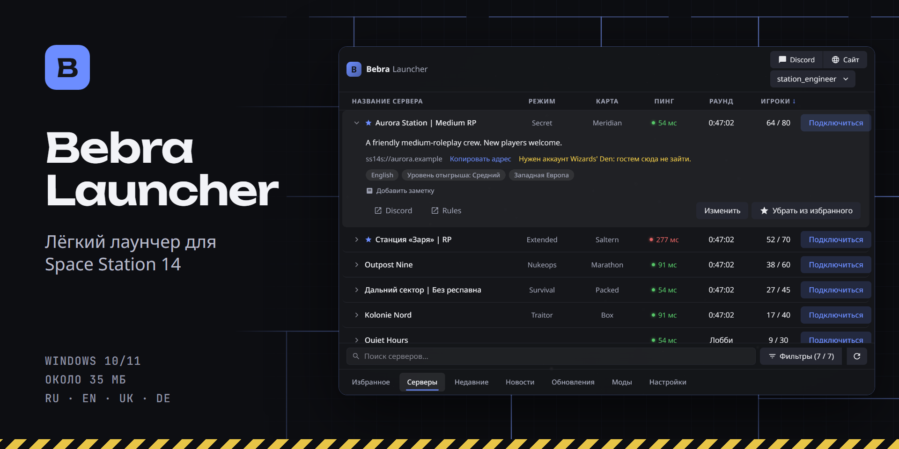
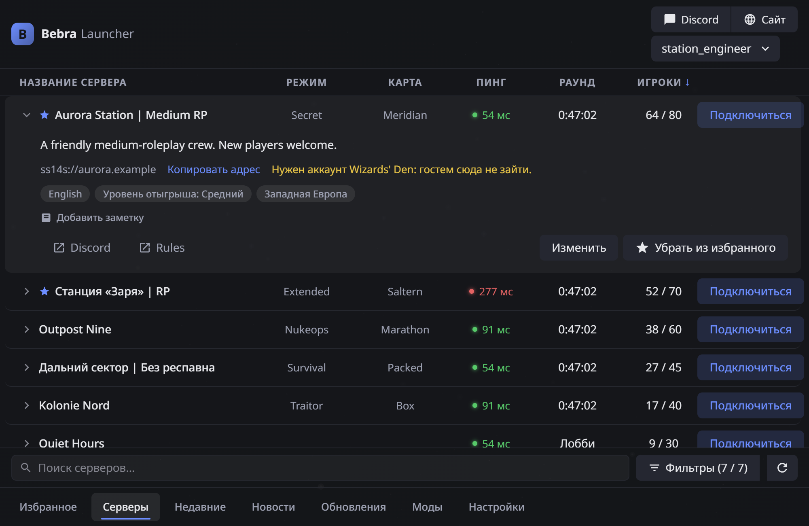
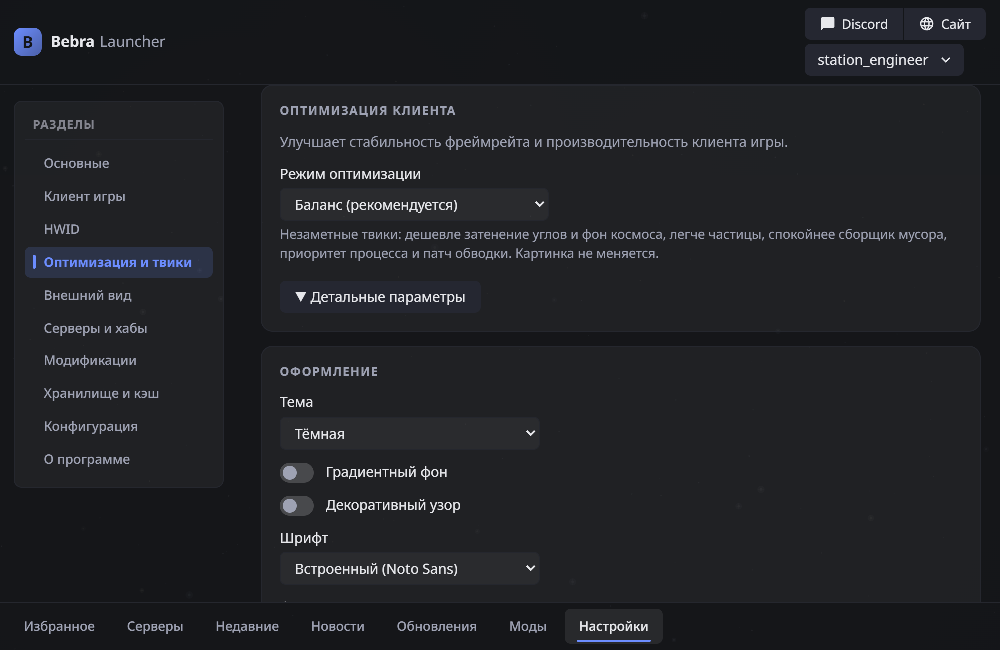
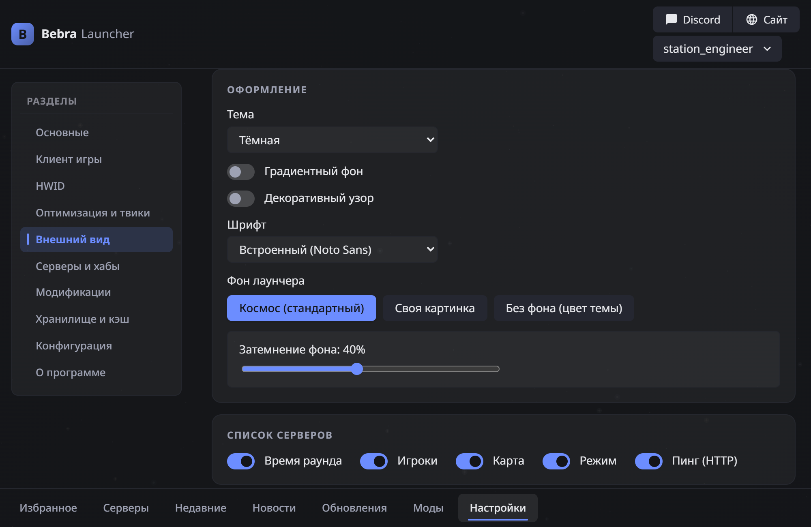
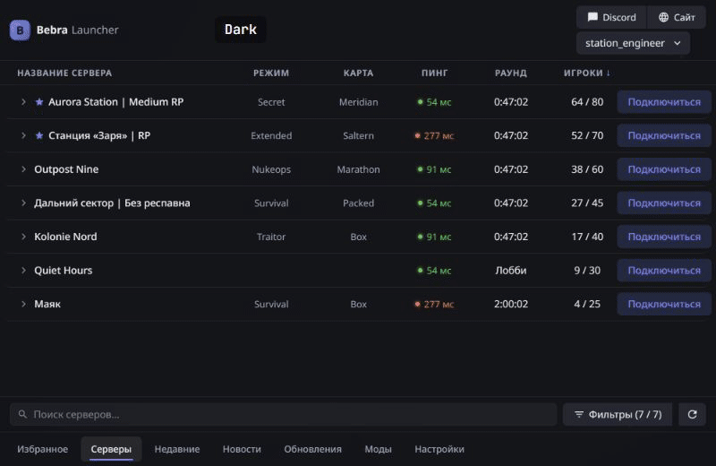

<p align="center">
  
</p>

<p align="center">
  <b>Русский</b> · <a href="README.en.md">English</a>
</p>

<p align="center">
  <a href="../../releases/latest"></a>
</p>

<p align="center">
  
  
  
</p>

BebraLauncher показывает серверы Space Station 14, запоминает ваши аккаунты и запускает игру. Компоновка знакома по официальному лаунчеру, а установщик весит около 35 МБ и уже включает игровой загрузчик и .NET.

<p align="center">
  
</p>

<sub>На скриншотах вымышленные серверы и аккаунты.</sub>

## Возможности

**Серверы.** Список с хаба Wizards' Den (хабы настраиваются), сортировка, поиск и фильтры по языку, региону, уровню отыгрыша и числу игроков. Без сети открывается сохранённый список.

**Избранное и история.** Избранные серверы, в том числе не из хаба, недавние, время игры на каждом сервере, заметки, прямое подключение и ссылки `ss14://`.

**Аккаунты.** Вход через официальный сервис Wizards' Den с двухфакторным кодом и игра гостем там, где сервер это разрешает. Для каждого сервера запоминается свой аккаунт.

**Запуск игры.** Скачивание и проверка билда, движка и модулей с прогрессом и отменой. Игра переподключается по запросу сервера (redial), а окно лаунчера сворачивается на время игры.

**Оптимизация клиента.** Готовые профили `standard`, `balanced` и `optimized` либо отдельные переключатели.

**Оформление.** 17 готовых тем и своя, которой можно поделиться через JSON. Фон, шрифт и масштаб интерфейса настраиваются.

**Локализация и моды.** Текстовые пакеты с переводами (`.zip`) и клиентские патчи (`.dll`) на отдельной вкладке.

**Обновления.** Новая версия приходит из релизов GitHub, проверяется подписью Ed25519 и ставится при закрытии или по кнопке.

<table>
  <tr>
    <td width="50%"></td>
    <td width="50%"></td>
  </tr>
</table>

<p align="center">
  
</p>

## Установка

1. Скачайте `*-setup.exe` со страницы [релизов](../../releases/latest).
2. Запустите установщик. Он пока не подписан сертификатом Windows, поэтому SmartScreen может показать предупреждение: нажмите «Подробнее», затем «Выполнить в любом случае».
3. Войдите в аккаунт или играйте гостем.

Нужны Windows 10 или 11 (x64) и WebView2, который в этих системах обычно уже есть.

## Что важно знать

> [!IMPORTANT]
> **Это неофициальный проект.** Он не связан с Space Wizards и авторами Space Station 14.

> [!WARNING]
> **HWID.** Лаунчер подставляет игре собственный идентификатор компьютера вместо настоящего и по умолчанию создаёт новый перед каждым запуском. Это настраивается в разделе «HWID». Серверы могут запрещать подмену: не используйте её для обхода блокировок.

> [!WARNING]
> **Моды.** Патчи `.dll` выполняются внутри игры с вашими правами, их автор и подпись не проверяются. Ставьте только те сборки, которым доверяете. Сервер может счесть патчи читерством. Все патчи отключаются одним действием, а изменённый после установки файл не загружается.

**Что с данными.** Пароль не сохраняется и не пишется в лог. Токен лежит в Диспетчере учётных данных Windows и продлевается сам. Файлы игры проверяются по SHA-256 и Ed25519. Из текстовых пакетов принимаются только файлы переводов, код из них не исполняется.

## Сборка из исходников

Нужны Rust (stable), Node.js 22, pnpm 10 и .NET 10 SDK. Для установщика также нужны VC++ CRT и интернет.

```powershell
# запуск в режиме разработки (сначала соберите Loader, см. loader/README.md)
cd app; pnpm install; pnpm tauri dev

# только интерфейс на тестовых данных, без бэкенда
cd app; pnpm dev

# установщик
pwsh scripts/build-release.ps1
```

<details>
<summary>Проверки перед коммитом</summary>

```powershell
cargo fmt --all --check
cargo clippy --workspace --all-targets -- -D warnings
cargo test --workspace
cd app; pnpm install; pnpm check; pnpm test
dotnet restore loader/SS14.Loader/SS14.Loader.csproj --locked-mode
dotnet build loader/SS14.Loader/SS14.Loader.csproj -c Release -warnaserror --no-restore
```
</details>

<details>
<summary>Устройство репозитория</summary>

| Путь | Что это |
| --- | --- |
| `crates/core` | Ядро без UI: хаб, сервер, авторизация, контент, движок, запуск, хранилище |
| `crates/cli` | Отладочный CLI `bebra` |
| `app/` | Интерфейс на Svelte и оболочка Tauri (`app/src-tauri`) |
| `loader/` | `SS14.Loader` из официального лаунчера и патчи клиента |
| `mods/` | Примеры клиентских патчей на Harmony |
| `scripts/` | Сборка, выпуск релиза и картинки для README (`readme-media`) |

Подробнее: [заметки об устройстве](NOTES.md), [протокол хаба и сервера](docs/protocol.md), [журнал изменений](CHANGELOG.md), [правила версий](docs/CHANGELOG_RULES.md).
</details>

## Участие

Об ошибках и идеях пишите в [Issues](../../issues), перед пул-реквестом загляните в [CONTRIBUTING](.github/CONTRIBUTING.md). Об уязвимостях сообщайте по правилам из [SECURITY](.github/SECURITY.md), не в открытых задачах.

## Лицензия

Код проекта распространяется по лицензии [MIT](LICENSE). `loader/` содержит код SS14.Launcher ([MIT](loader/LICENSE-SS14.Launcher.txt)), лицензии остальных компонентов установщика перечислены в [THIRD-PARTY-NOTICES](loader/THIRD-PARTY-NOTICES.txt).

Палитры части тем и некоторые настройки взяты из MusyaLoader (AGPL). Их лицензионный статус сейчас уточняется.

Space Station 14 принадлежит её авторам. Название используется только для указания, с какой игрой работает лаунчер.
